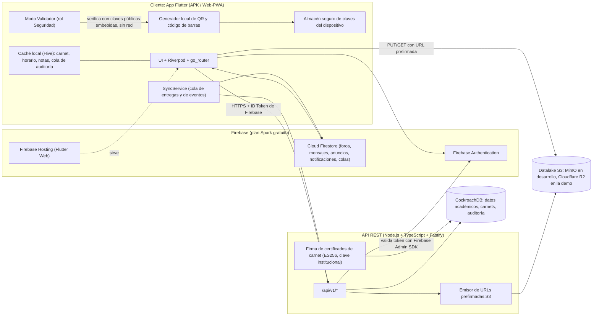
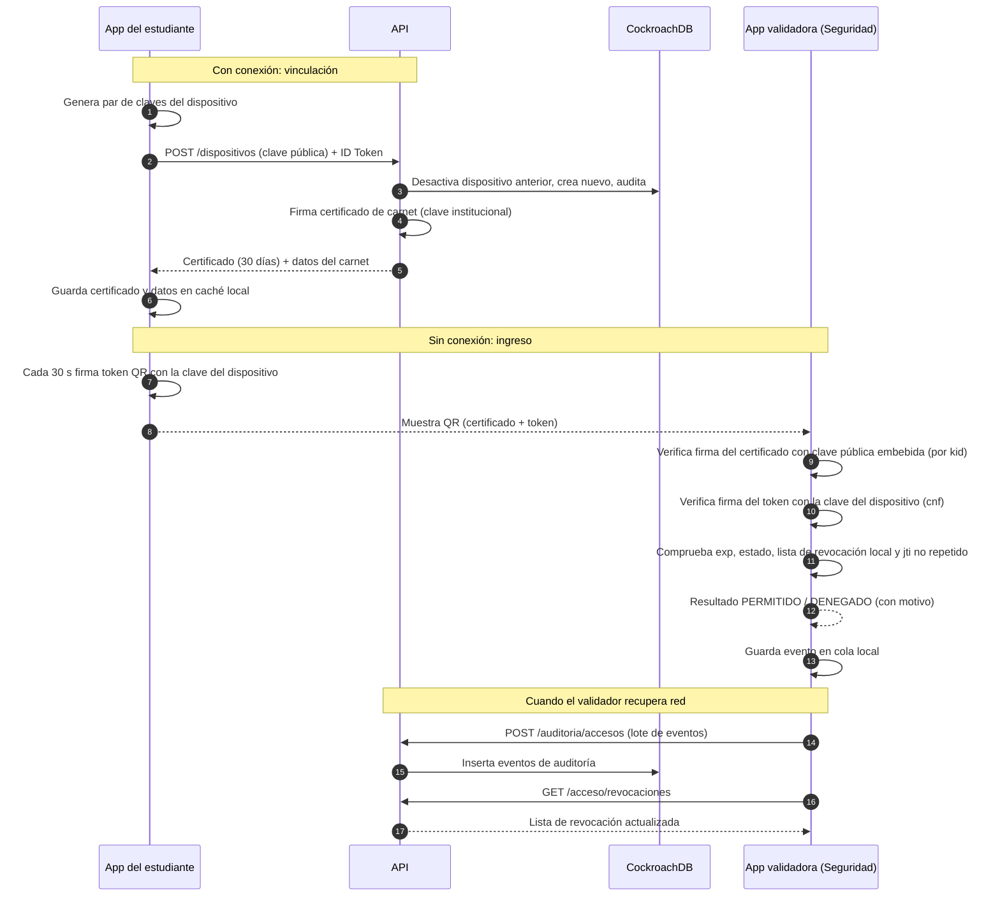
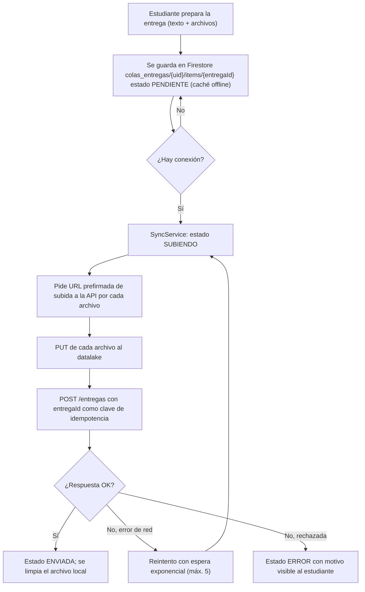

# arquitectura.md — Uniminuto Campus App (muestra universitaria)

> **Destinatario del documento:** harness de generación de código (DeepSeek).
> **Regla de lectura:** todo lo aquí escrito es una **decisión cerrada**. Si algo no está especificado, el harness debe elegir la opción más simple coherente con este documento y registrarla en `docs/DECISIONES.md`; nunca debe cambiar el stack ni añadir funcionalidades fuera de alcance.

---

## 1. Resumen ejecutivo

**Nombre del proyecto:** Uniminuto Campus App (nombre de trabajo: `campus_app`).

**Propósito:** una única aplicación móvil (APK Android) que unifica las funciones más usadas de tres sistemas de la sede Bogotá – Calle 80 de Uniminuto:

| Sistema origen | Qué se replica en la app |
|---|---|
| **U-Wallet** | Carnet digital con QR dinámico firmado (ingreso por torniquetes, validación 100 % offline), código de barras (biblioteca, bicicletero, parqueadero, préstamo de equipos) y gestión de dispositivo vinculado. |
| **Génesis** | Perfil académico, asignaturas inscritas, calificaciones por corte y por actividad, horario con ubicación de salón, cambio de contraseña y evaluación docente. |
| **Aulas Virtuales** | Aulas por grupo/asignatura, contenido por unidades, tareas, cuestionarios, foros, anuncios, participantes y calificaciones. |

**Alcance y naturaleza:** es una **muestra funcional para un trabajo universitario**. No hay usuarios reales, **no existe integración con Génesis, U-Wallet, Aulas Virtuales ni con torniquetes físicos**; todo se simula con datos ficticios (semilla) y con un "modo validador" dentro de la propia app. La arquitectura tiene una visión moderada de expansión: separación clara de capas, contratos de API versionados y migraciones de base de datos, sin infraestructura de nivel empresarial.

**Visualización:** la misma base de código Flutter se compila a Web y se publica en un host gratuito para la demo, mostrada con proporciones de teléfono.

### 1.1 Fuera de alcance (el harness NO debe implementar)

- Atención al usuario con IA, chatbots o cualquier servicio de IA dentro de la app.
- Integración real con Génesis, torniquetes, sistemas de biblioteca/parqueadero o servidores de correo reales.
- Pagos, blockchain, logs inmutables, microservicios, Kubernetes, colas de mensajería externas.
- Aplicación iOS (el código Flutter lo permitiría, pero no se construye ni se prueba).
- Panel web separado: el "panel administrativo" es una sección de la misma app Flutter visible solo para roles administrativos.

---

## 2. Diagrama de componentes

### 2.1 Vista general

### 2.2 Qué funciona offline y qué no

| Funcionalidad | Sin conexión | Mecanismo |
|---|---|---|
| Mostrar carnet (foto, nombre, código, programa, estado) | Sí | Caché local de la última respuesta + foto cacheada en disco. |
| Generar QR dinámico y código de barras | **Sí (obligatorio)** | Firma local con clave del dispositivo + certificado de carnet ya descargado. |
| Validar QR en portería | **Sí (obligatorio)** | Claves públicas institucionales embebidas en la app validadora; lista de revocación local. |
| Leer foros, mensajes, anuncios ya cargados | Sí | Persistencia offline nativa de Firestore. |
| Escribir en foros / preparar una entrega | Sí (queda pendiente) | Escritura en Firestore con caché local; se sincroniza al volver la red. |
| Consultar horario, notas, asignaturas | Sí (última versión vista) | Caché local de solo lectura (Hive). |
| Subir archivos, enviar entrega definitiva, calificar, cuestionarios | No | Requiere API y datalake. |
| Vincular, cambiar o revocar dispositivo; cambiar contraseña | No | Solo con conexión (requisito explícito). |

---

## 3. Decisiones tecnológicas justificadas

### 3.1 Stack fijado (no cambiar)

| Capa | Tecnología | Por qué se eligió (y sobre qué alternativas) |
|---|---|---|
| Frontend móvil + web | **Flutter (Dart), canal estable** | Un solo código para APK y Web. Frente a React Native o PWA pura, ofrece UI idéntica en ambas plataformas y excelente soporte de Firebase. |
| Hosting de la demo | **Firebase Hosting (Spark)**; alternativa **GitHub Pages** | CDN, SSL y despliegue de un comando; se integra con el mismo proyecto Firebase. GitHub Pages sirve si no se quiere usar Hosting (solo estático). |
| NoSQL comunicación/offline | **Cloud Firestore** | Persistencia offline nativa en el SDK y sincronización automática. Se descarta MongoDB Realm porque Device Sync fue deprecado en septiembre de 2025. |
| SQL distribuido (datos críticos) | **CockroachDB** (CockroachDB Cloud capa gratuita para la demo; nodo único en Docker para desarrollo) | Transacciones ACID y compatibilidad con PostgreSQL. Se descarta Cassandra (consistencia eventual) y TiDB (más pesado para una muestra). |
| Datalake de archivos | **MinIO** (desarrollo local) y **Cloudflare R2** (demo en nube), ambos vía API S3 | Un único código (SDK S3) y se cambia solo la configuración. R2 no cobra egreso y tiene capa gratuita. |
| QR offline | **JWT firmado ES256** | Verificable sin red con la clave pública. ES256 produce firmas cortas (64 bytes), lo que mantiene el QR legible. |

### 3.2 Decisiones complementarias (cerradas por este documento)

El stack no incluía autenticación ni un backend intermedio, pero son necesarios. Se fijan así:

| Necesidad | Decisión | Justificación |
|---|---|---|
| Identidad y sesión | **Firebase Authentication** (correo + contraseña) | Gratis en Spark, ya integrado con Firestore, permite cambio real de contraseña. Los roles viajan como *custom claims*. |
| Acceso a CockroachDB | **API REST propia: Node.js 20 + TypeScript + Fastify** con driver `pg` | Flutter no debe conectarse directo a una base SQL. Firebase Cloud Functions exige plan de pago, por eso se usa un servicio aparte. |
| Hosting de la API | **Render (plan gratuito)** para la demo; `docker-compose` para desarrollo | Gratuito; advertir que el primer request tras inactividad puede tardar (arranque en frío). |
| Estado en Flutter | **Riverpod** | Sencillo, testeable y sin boilerplate. |
| Navegación | **go_router** | Rutas declarativas con guardas por rol. |
| HTTP | **dio** | Interceptores para adjuntar el ID Token y reintentos. |
| Caché local | **hive_ce** | Funciona igual en móvil y web. |
| Claves del dispositivo | **flutter_secure_storage** (Android Keystore) y, en Web, WebCrypto con clave no exportable guardada en IndexedDB | Evita que la clave privada del dispositivo salga del equipo. |
| QR / barras / escaneo | `qr_flutter`, `barcode_widget` (Code 128), `mobile_scanner` | Generación 100 % local; el escáner es necesario para el modo validador. |
| JWT en cliente | `dart_jsonwebtoken` (ES256) | Firma y verificación locales. |
| Validación de datos en API | **Zod** | Esquemas únicos de entrada/salida. |
| Migraciones | Archivos SQL numerados (`node-pg-migrate`) | Esquema reproducible en cualquier entorno. |

> **Nota obligatoria para CockroachDB:** el nivel de aislamiento por defecto es SERIALIZABLE y puede devolver error de reintento (código SQLSTATE `40001`). La capa de acceso a datos debe envolver toda transacción en una función de **reintento automático** (máximo 3 intentos con espera exponencial).

---

## 4. Modelo de datos de alto nivel

### 4.1 Reparto entre almacenes

| Almacén | Qué guarda | Por qué |
|---|---|---|
| **CockroachDB** | Usuarios, roles, carnets, dispositivos, estructura académica (periodos, asignaturas, grupos, inscripciones), aulas, unidades, contenidos (metadatos), actividades, calificaciones, notas de corte, horarios, edificios/pisos/salones, evaluación docente, incidencias, correos simulados y auditoría. | Requieren integridad, transacciones y consultas relacionales. |
| **Cloud Firestore** | Foros (hilos y mensajes), anuncios, notificaciones y cola local de entregas pendientes. | Escritura/lectura con caché offline y sincronización. |
| **Datalake S3** | Archivos: PDFs, videos, imágenes, adjuntos de foros y entregas, fotos de carnet. | Almacenamiento de objetos; la BD solo guarda *key* y metadatos. |
| **Hive (dispositivo)** | Caché de lectura, certificado de carnet, cola de eventos de validación pendientes de subir. | Funcionamiento sin red. |

### 4.2 Entidades en CockroachDB (descripción, sin DDL)

**Identidad y acceso**

| Entidad | Campos principales | Relaciones |
|---|---|---|
| `usuario` | id (UUID), uid_firebase, nombres, apellidos, correo, documento, código_institucional, programa_id (si es estudiante), foto_key, estado | 1–N `usuario_rol`, 1–N `carnet`, 1–N `inscripcion` |
| `rol` | id, nombre (`ESTUDIANTE`, `DOCENTE`, `ADMIN_ACADEMICO`, `ADMIN_ESPACIOS`, `SEGURIDAD`, `SOPORTE`, `AUDITOR`) | N–M con `usuario` vía `usuario_rol` |
| `carnet` | id, usuario_id, código_barras (texto Code 128), estado (`ACTIVO`, `SUSPENDIDO`, `VENCIDO`), vigente_hasta | N–1 `usuario`; 1–N `dispositivo` |
| `dispositivo` | id, carnet_id, nombre_dispositivo, clave_pública_jwk, huella (thumbprint), estado (`ACTIVO`, `REVOCADO`), vinculado_en, revocado_en, revocado_por | N–1 `carnet`. Regla: **un solo dispositivo ACTIVO por carnet.** |
| `certificado_carnet` | id, dispositivo_id, kid_institucional, emitido_en, expira_en, jwt_firmado | 1–1 con el dispositivo activo vigente |
| `lista_revocacion` | carnet_id, motivo, desde | Fuente de la lista que descargan los validadores |
| `incidencia` | id, usuario_id, descripción, estado (`ABIERTA`, `EN_CURSO`, `CERRADA`), atendida_por | N–1 `usuario` |

**Estructura académica**

| Entidad | Campos principales | Relaciones |
|---|---|---|
| `programa` | id, nombre | 1–N `usuario` (estudiantes) |
| `periodo` | id, código (ej. `2026-2`), tipo (`SEMESTRAL`, `CUATRIMESTRAL`), fecha_inicio, fecha_fin, activo | 1–N `grupo` |
| `asignatura` | id, código, nombre, créditos | 1–N `grupo` |
| `grupo` | id, asignatura_id, periodo_id, docente_id, número_grupo | 1–1 `aula`; 1–N `inscripcion`, `horario`, `corte` |
| `inscripcion` | id, estudiante_id, grupo_id, estado | N–1 `usuario`, N–1 `grupo`; 1–N `calificacion`, `nota_corte` |

**Aulas Virtuales**

| Entidad | Campos principales | Relaciones |
|---|---|---|
| `aula` | id, grupo_id, nombre, descripción | 1–N `unidad`, `anuncio_ref` |
| `unidad` | id, aula_id, número (semana/unidad), título | 1–N `contenido`, `actividad` |
| `contenido` | id, unidad_id, tipo (`PDF`, `VIDEO`, `ENLACE`, `ANUNCIO`), título, descripción, objeto_key (nulo si es enlace), url_externa, mime, tamaño | N–1 `unidad` |
| `actividad` | id, unidad_id, tipo (`TAREA`, `CUESTIONARIO`, `FORO`), título, instrucciones, abre_en, cierra_en, corte_id, **peso_porcentual** (dentro del corte), nota_máxima (por defecto 5.0), adjuntos | N–1 `unidad`; N–1 `corte`; 1–N `entrega`, `calificacion` |
| `pregunta` / `opcion_respuesta` | enunciado, tipo (opción única o múltiple), opciones y cuál es correcta | N–1 `actividad` de tipo cuestionario |
| `intento_cuestionario` | id, actividad_id, estudiante_id, respuestas, puntaje, enviado_en | N–1 `actividad` |
| `entrega` | id (UUID generado en el cliente, sirve como clave de idempotencia), actividad_id, estudiante_id, texto, adjuntos (keys), creada_en_cliente, recibida_en_servidor, estado (`ENVIADA`, `TARDIA`) | N–1 `actividad` |
| `participante_aula` | aula_id, usuario_id, rol_en_aula | Deriva de inscripciones y del docente del grupo |

**Calificaciones (estructura de cortes y actividades)**

| Entidad | Campos principales | Reglas |
|---|---|---|
| `corte` | id, grupo_id, número (1, 2, 3), peso_porcentual (valores por defecto 30, 30, 40) | Los pesos de los cortes de un grupo suman 100. |
| `calificacion` | id, actividad_id, inscripcion_id, nota (0.0–5.0), retroalimentación, calificada_por, calificada_en | Una por actividad e inscripción. |
| `nota_corte` | inscripcion_id, corte_id, nota_calculada | Se recalcula **dentro de la misma transacción** que cambia una `calificacion`. |

Fórmulas fijas (escala 0.0–5.0):
- **Nota de corte** = Σ(nota de la actividad × peso de la actividad) / Σ(pesos de las actividades calificadas del corte).
- **Definitiva** = Σ(nota de corte × peso del corte), tratando como 0 los cortes sin nota.
- Los pesos de las actividades de un corte deben sumar 100; la API rechaza publicar una actividad que haga exceder 100.

**Horarios y espacios**

| Entidad | Campos principales | Relaciones |
|---|---|---|
| `edificio` | id, código (`A`, `B`, `C`), nombre, sede (`CALLE_80`) | 1–N `piso` |
| `piso` | id, edificio_id, número, tipo (`ESTUDIANTIL`, `ADMINISTRATIVO`) | 1–N `salon` |
| `salon` | id, piso_id, código (ej. `A-304`), tipo (`AULA`, `LABORATORIO`, `OFICINA`), capacidad | N–1 `piso` |
| `horario` | id, grupo_id, salon_id, día_semana, hora_inicio, hora_fin | N–1 `grupo`, N–1 `salon` |

**Otras**

| Entidad | Campos principales |
|---|---|
| `evaluacion_docente` | id, inscripcion_id, docente_id, respuestas (escala 1–5 por criterio), comentario, enviada_en. Única por inscripción. |
| `correo_simulado` | id, destinatario, asunto, cuerpo, creado_en (sustituye al envío real de correo). |
| `evento_auditoria` | id, **timestamp, actor_id, accion, recurso, resultado** |

### 4.3 Estructura del campus Calle 80 (datos semilla obligatorios)

La estructura es una estimación declarada. El código de salón sigue el patrón `<Edificio>-<Piso><NN>`.

| Edificio | Pisos estudiantiles | Salones por piso | Pisos administrativos | Total salones estudiantiles |
|---|---|---|---|---|
| **A** | 1 a 4 | 10 (`A-101`…`A-110`, `A-201`…, etc.) | 1 (piso 5) | 40 |
| **B** | 1 a 5 | 10 | 3 (pisos 6 a 8) | 50 |
| **C** | 1 a 5 | 10 | 3 (pisos 6 a 8) | 50 |

- Los pisos administrativos se crean con `tipo = ADMINISTRATIVO` y 3 a 5 salones de tipo `OFICINA` cada uno (nombres tipo `B-601`).
- Los salones de pisos estudiantiles son `AULA`; marcar 2 por edificio como `LABORATORIO`.
- La app muestra la vista jerárquica **Edificio → Piso → Salón** y, desde un horario, enlaza al salón.

### 4.4 Colecciones de Firestore

| Ruta | Contenido | Quién escribe |
|---|---|---|
| `aulas_index/{aulaId}` | `miembros` (arreglo de uid de Firebase), `docentes` (arreglo de uid) | Solo la API (Admin SDK); espejo para las reglas de seguridad |
| `foros/{foroId}/hilos/{hiloId}` | título, autor_uid, creado_en, aula_id | Miembros del aula |
| `foros/{foroId}/hilos/{hiloId}/mensajes/{msgId}` | texto, autor_uid, adjuntos (keys del datalake), creado_en | Miembros del aula |
| `anuncios/{aulaId}/items/{id}` | título, cuerpo, autor_uid, importante (bool), creado_en | Docentes del aula |
| `notificaciones/{uid}/items/{id}` | tipo, título, ref, leída, creada_en | API (y reglas permiten marcar leída al dueño) |
| `colas_entregas/{uid}/items/{entregaId}` | actividad_id, texto, archivos_locales (metadatos), estado (`PENDIENTE`, `SUBIENDO`, `ENVIADA`, `ERROR`), intentos | Dueño |

**Reglas de seguridad de Firestore (descripción):** lectura y escritura solo para usuarios autenticados; foros y anuncios accesibles únicamente si el uid figura en `aulas_index/{aulaId}.miembros`; anuncios con escritura solo para `docentes`; cada usuario solo accede a su propio árbol `notificaciones/{uid}` y `colas_entregas/{uid}`; las reglas leen el rol desde los *custom claims*.

---

## 5. Roles y permisos (RBAC)

Convención: **C** crear, **R** leer, **U** actualizar, **D** eliminar; **R\*** = solo lo propio; **R\*\*** = solo de sus aulas/grupos; **—** = sin acceso.

| Recurso | Estudiante | Docente | Admin Académico | Admin Espacios | Seguridad | Soporte | Auditor |
|---|---|---|---|---|---|---|---|
| Carnet propio (ver, QR, barras) | R\* | R\* | R\* | R\* | R\* | R | — |
| Dispositivo vinculado | C/R/U\* (vincular, cambiar, revocar el propio) | C/R/U\* | C/R/U\* | C/R/U\* | C/R/U\* | R + **revocar de cualquiera** | — |
| Validación de acceso offline (modo validador) | — | — | — | — | **C/R** | — | — |
| Lista de revocación (descarga) | — | — | — | — | R | — | — |
| Aulas: contenido, unidades | R\*\* | C/R/U/D\*\* | R | — | — | — | — |
| Actividades (tareas, cuestionarios, foros) | R\*\* | C/R/U/D\*\* | R | — | — | — | — |
| Entregas | C/R\* | R\*\* | — | — | — | — | — |
| Foros y mensajes | C/R\*\* | C/R/U/D\*\* | — | — | — | — | — |
| Calificación y retroalimentación | R\* | C/R/U\*\* | R | — | — | — | — |
| Progreso de estudiantes | — | R\*\* | R | — | — | — | — |
| Notas por corte/actividad (Génesis) | R\* | R\*\* | R | — | — | — | — |
| Grupos, periodos, asignaturas | — | R\*\* | C/R/U/D | — | — | — | — |
| Asignación de docentes a grupos | — | — | C/R/U | — | — | — | — |
| Inscripciones | R\* | R\*\* | C/R/U | — | — | — | — |
| Horario | R\* | R\* | R | R | — | — | — |
| Catálogo de edificios, pisos, salones | R | R | R | C/R/U/D | — | — | — |
| Asignación de salones a horarios | — | — | R | C/R/U/D | — | — | — |
| Evaluación docente | C/R\* | — | R (agregados) | — | — | — | — |
| Perfil y contraseña propios | R/U\* | R/U\* | R/U\* | R/U\* | R/U\* | R/U\* | R/U\* |
| Incidencias | C/R\* | C/R\* | C/R\* | C/R\* | C/R\* | R/U (gestionar) | — |
| Auditoría (`evento_auditoria`) | — | — | — | — | — (solo escribe eventos de validación) | — | **R** |

**Implementación:** al crear o cambiar roles, la API asigna *custom claims* en Firebase (`roles: [...]`). Cada ruta de la API declara los roles permitidos y la API **siempre** aplica el filtro de propiedad (`R*`, `R**`) en la consulta, nunca solo en la UI. Un usuario puede tener varios roles; la app muestra un selector de rol activo cuando aplica. El rol Seguridad **nunca** recibe endpoints de datos académicos.

---

## 6. Flujos clave

### 6.1 Generación y validación offline del QR

**Principio de diseño:** la clave que firma el QR **no** es la clave institucional (no puede estar en el teléfono). Se usa una cadena de confianza de dos niveles.

| Elemento | Quién lo genera | Dónde vive |
|---|---|---|
| Par de claves institucional ES256 (con `kid`) | Script de infraestructura (`infra/scripts`) una sola vez | Privada: variable de entorno secreta del backend. Pública: **embebida en el build de la app validadora** (lista de `kid` → clave pública, para permitir rotación). |
| Par de claves del dispositivo ES256 | La app, al vincular | Privada: almacén seguro del dispositivo (no exportable). Pública: se envía a la API. |
| **Certificado de carnet** (JWT firmado por la clave institucional) | API, al vincular o renovar | Se descarga y se guarda en caché local del dispositivo. |
| **Token QR** (JWT firmado por la clave del dispositivo) | App, cada 30 s | Solo se muestra como QR; no se guarda. |

**Contenido del certificado de carnet (claims):** `iss` (institución), `kid` (cabecera), `sub` (id de carnet), `cod` (código institucional), `est` (estado), `cnf` (clave pública del dispositivo en JWK), `iat`, `exp` (**30 días**).

**Contenido del token QR (claims):** `sub` (id de carnet), `jti` (contador creciente + aleatorio corto), `iat`, `exp` (**60 s**), y el certificado adjunto. Para mantener el QR escaneable, el QR codifica una cadena compacta `<certificado>.<tokenQR>` con nivel de corrección de errores bajo/medio; el harness no debe añadir claims adicionales (ni foto ni nombre).

**Reglas de validación del modo validador (en este orden; primer fallo = DENEGADO):**

1. Formato válido y `kid` conocido.
2. Firma del certificado válida.
3. Certificado no vencido (tolerancia de reloj ±60 s).
4. `est` = `ACTIVO` y `sub` ausente de la lista de revocación local.
5. Firma del token QR válida con la clave `cnf`.
6. Token no vencido (60 s, tolerancia ±30 s).
7. `jti` no visto antes en la caché local de los últimos 5 minutos (anti-repetición).

**Códigos de motivo:** `OK`, `FORMATO_INVALIDO`, `KID_DESCONOCIDO`, `FIRMA_CERT_INVALIDA`, `CERT_VENCIDO`, `CARNET_REVOCADO`, `FIRMA_QR_INVALIDA`, `QR_VENCIDO`, `QR_REPETIDO`.

**Limitaciones que el documento reconoce (y la UI debe mostrar en la ayuda del modo validador):** una revocación solo surte efecto en un validador cuando éste sincroniza su lista; un certificado ya emitido sigue siendo válido offline hasta su expiración si el validador no tiene la lista actualizada. Esto es inherente a la validación offline y se acepta en la muestra.

**Renovación:** si el certificado vence en menos de 7 días y hay red, la app pide uno nuevo en segundo plano. Si vence sin red, el QR muestra un aviso "Conéctate para renovar el carnet" (es la única situación en que el QR deja de funcionar offline).

**Mock de torniquete:** el harness implementa el "Modo Validador" como una pantalla de la app visible solo con rol Seguridad (cámara + resultado en pantalla verde/rojo + historial local). En Web debe permitir pegar el texto del QR como alternativa a la cámara. **No** se simula hardware.

**Código de barras:** Code 128 con el `código_barras` del carnet, generado localmente y mostrado en una pestaña del carnet con cuatro etiquetas de uso (biblioteca, bicicletero, parqueadero, préstamo de equipos). Es un identificador no firmado; la muestra no implementa los lectores de esos servicios.

### 6.2 Sincronización de Firestore (foros y colas de entregas)

- **Persistencia offline:** en móvil está activa por defecto; en Web debe habilitarse explícitamente al inicializar (limitación conocida: una sola pestaña con persistencia a la vez).
- **Foros/anuncios/notificaciones:** *online-first*. La app se suscribe con listeners en tiempo real; si no hay red muestra la caché con un indicador "sin conexión". Los mensajes escritos offline se envían solos al reconectar (comportamiento del SDK).
- **Mensajes importantes → correo simulado:** cuando un docente publica un anuncio con `importante = true`, la app llama a `POST /anuncios/{id}/replicar-correo`; la API inserta una fila por estudiante en `correo_simulado`. Una pantalla "Bandeja simulada" (visible para el propio usuario) muestra esos correos.
- **Cola de entregas:**

- **Fecha de entrega:** se guardan `creada_en_cliente` y `recibida_en_servidor`. La entrega es `ENVIADA` si `creada_en_cliente ≤ cierra_en`, y `TARDIA` en caso contrario. Se acepta hasta 24 h después del cierre recibida por el servidor (período de gracia configurable); pasado ese límite se rechaza. Esta regla es la que hace justa la entrega preparada sin conexión.
- **Idempotencia:** `POST /entregas` con un `entregaId` ya existente devuelve la misma respuesta, sin duplicar.

### 6.3 Ingesta de archivos al datalake y metadatos

1. La app pide `POST /archivos/subida` con `{contexto, nombre, mime, tamaño}`.
2. La API valida permisos (ej. solo docentes del aula suben contenido; solo miembros adjuntan a foros), tipo MIME y tamaño (**máximo 50 MB** por archivo en la demo) y devuelve `{objeto_key, url_put}` (expira en 10 minutos).
3. La app hace `PUT` directo al datalake con esa URL (el archivo no pasa por la API).
4. La app confirma con la operación que crea el recurso (contenido, entrega o mensaje de foro) enviando solo `objeto_key` y metadatos; la API verifica con una consulta de existencia al bucket antes de guardar.
5. Para descargar, la app pide `GET /archivos/{id}/url` y recibe una URL prefirmada de lectura (expira en 15 minutos). Los videos se reproducen con esa misma URL (soporta rangos de bytes).

**Convención de claves (bucket privado `campus-app`):**

| Prefijo | Uso |
|---|---|
| `aulas/{aulaId}/contenido/{uuid}-{nombre}` | PDFs, videos e imágenes del docente |
| `entregas/{actividadId}/{estudianteId}/{uuid}-{nombre}` | Archivos de entregas |
| `foros/{foroId}/{uuid}-{nombre}` | Adjuntos de foros |
| `perfiles/{usuarioId}.jpg` | Foto del carnet |

El bucket es **privado**: nunca se exponen URLs públicas. MIME permitidos en la demo: PDF, imágenes (PNG/JPEG/WebP), MP4, DOCX, XLSX, PPTX, ZIP y texto plano.

### 6.4 Registro de calificaciones por corte y actividad

1. El docente abre una actividad de su aula y califica a un estudiante (`PUT /calificaciones` con `inscripcion_id`, `actividad_id`, `nota`, `retroalimentacion`).
2. La API, **en una sola transacción** (con reintento por `40001`): valida que el docente pertenece al grupo y que `0 ≤ nota ≤ nota_máxima`; hace *upsert* en `calificacion`; recalcula `nota_corte` del corte de la actividad; inserta `evento_auditoria` (`accion = CAMBIO_NOTA`, `recurso = calificacion:{id}`, `resultado = OK`); crea una notificación en Firestore para el estudiante.
3. El estudiante consulta `GET /mis-notas?periodo=` y recibe, por asignatura: notas por corte (definitiva de cada corte) y detalle por actividad con **peso**, fecha y retroalimentación, más la definitiva calculada. Esta respuesta se guarda en caché local para lectura offline.
4. Cuestionarios: la API autocalifica al recibir el intento y registra la `calificacion` por el mismo camino. Tareas y foros se califican manualmente.

---

## 7. Estrategia de despliegue y hosting para la demo

### 7.1 Estructura del repositorio (monorepo)

| Carpeta | Contenido |
|---|---|
| `app/` | Proyecto Flutter. Organización por *features*: `auth`, `carnet`, `validador`, `aulas`, `horarios`, `academico`, `perfil`, `admin`, `core` (api, cache, sync, seguridad). |
| `api/` | Servicio Fastify. Módulos: `auth`, `carnet`, `acceso`, `aulas`, `actividades`, `calificaciones`, `horarios`, `espacios`, `archivos`, `auditoria`, `admin`. |
| `infra/` | `docker-compose.yml` (CockroachDB nodo único + MinIO), scripts de migración, de generación de claves y de semilla. |
| `docs/` | Este archivo, `DECISIONES.md` y la guía de demo. |

### 7.2 Entornos y configuración

| Variable / ajuste | Dónde | Notas |
|---|---|---|
| Configuración del proyecto Firebase en la app | `firebase_options.dart` generado con **FlutterFire CLI** | No contiene secretos; son identificadores públicos. |
| `API_BASE_URL`, `ENTORNO` | Archivos `app/env/dev.json` y `app/env/prod.json`, pasados con `--dart-define-from-file` | Aquí **no** van secretos. |
| `DATABASE_URL`, `FIREBASE_SERVICE_ACCOUNT`, `INSTITUTION_PRIVATE_KEY`, `INSTITUTION_KID`, `S3_ENDPOINT`, `S3_ACCESS_KEY`, `S3_SECRET_KEY`, `S3_BUCKET`, `CORS_ORIGINS` | Variables de entorno de la API (archivo `.env` local, panel de Render en la demo) | **Nunca** se suben al repositorio; incluir `.env.example` con nombres y sin valores. |
| Clave pública institucional | Constante del build del validador, tomada del script de generación de claves | Se versiona (es pública). |

### 7.3 Desarrollo local

1. Levantar `docker-compose` de `infra/` (CockroachDB nodo único y MinIO); crear el bucket `campus-app`.
2. Ejecutar migraciones y luego el script de **semilla** (ver 7.6).
3. Arrancar la API en local; apuntar la app con `dev.json`.
4. Proyecto Firebase propio (plan Spark): activar Authentication (correo/contraseña) y Firestore; desplegar las reglas de seguridad.

### 7.4 Despliegue de la demo web

**Base de datos (CockroachDB Cloud, capa gratuita):**
1. Crear un clúster gratuito y una base de datos `campus`.
2. Crear un usuario SQL para la API y copiar la cadena de conexión a `DATABASE_URL` (exige TLS).
3. Ejecutar migraciones y semilla contra ese clúster.

**Datalake (Cloudflare R2):** crear el bucket privado `campus-app`, generar credenciales S3 y configurar `S3_ENDPOINT` con el endpoint de la cuenta. Configurar CORS del bucket para permitir `PUT` y `GET` desde el dominio de la demo. En desarrollo se usa MinIO con las mismas variables.

**API (Render):** servicio web desde la carpeta `api/`, variables de entorno cargadas en el panel, comprobación de salud en `/health`. Establecer `CORS_ORIGINS` con el dominio de Hosting.

**App web (Firebase Hosting):**
1. `flutter build web --release` usando `--dart-define-from-file=env/prod.json`. La salida queda en `build/web`.
2. `firebase init hosting` una sola vez: directorio público `build/web`, aplicación de una sola página (reescritura de todas las rutas a `index.html`).
3. `firebase deploy --only hosting`.
4. Añadir el dominio de Hosting a los dominios autorizados de Firebase Authentication.

**Alternativa GitHub Pages:** compilar con `--base-href "/<nombre-del-repo>/"`, publicar el contenido de `build/web` en la rama `gh-pages` (o con GitHub Actions) y activar Pages. Añadir el dominio `<usuario>.github.io` a los dominios autorizados de Firebase Authentication y a `CORS_ORIGINS`. Como Pages no reescribe rutas, usar estrategia de URL con `#` en go_router para esa variante.

### 7.5 Experiencia móvil en la web

- El `index.html` y `manifest.json` deben declarar la app como **PWA**: `display: standalone`, `orientation: portrait`, nombre, colores e íconos de Uniminuto (genéricos, sin usar logotipos oficiales con licencia).
- En pantallas anchas (> 600 px de ancho) la app se renderiza dentro de un **contenedor centrado de ancho máximo 430 px y alto de viewport**, con fondo neutro y borde sutil, imitando un teléfono. En pantallas ≤ 600 px ocupa todo el ancho. Este comportamiento se implementa una sola vez en el widget raíz.
- La cámara (modo validador) requiere HTTPS, que Hosting y Pages ofrecen por defecto.
- **Distribución del APK:** `flutter build apk --release` y entrega del archivo para instalación manual (sin Google Play).

### 7.6 Datos semilla (todos ficticios)

| Conjunto | Cantidad mínima |
|---|---|
| Usuarios por rol | 3 estudiantes, 2 docentes, 1 admin académico, 1 admin de espacios, 1 seguridad, 1 soporte, 1 auditor |
| Programa y periodo | 1 programa; periodo activo `2026-2` (semestral) |
| Asignaturas y grupos | 4 asignaturas, 1 grupo cada una, cada una con 3 cortes (30/30/40) |
| Inscripciones | Los 3 estudiantes inscritos en las 4 asignaturas |
| Aulas | 1 por grupo; 3 unidades con contenido variado (PDF, enlace, video corto, anuncio) |
| Actividades | Por aula: 2 tareas, 1 cuestionario (5 preguntas), 1 foro; con pesos que sumen 100 por corte; algunas ya calificadas |
| Campus | Edificios, pisos y salones según 4.3; horarios que referencien salones reales |
| Credenciales | Contraseña de demostración documentada en la guía de demo; correos con dominio ficticio (`@demo.uniminuto.test`) |

El script de semilla debe ser **idempotente** (puede ejecutarse varias veces) y crear también los usuarios en Firebase Authentication con sus *custom claims*.

### 7.7 Contrato de API (resumen de endpoints, prefijo `/api/v1`)

Todas las rutas (salvo `/health`) exigen `Authorization: Bearer <ID Token de Firebase>`. Respuestas en JSON; errores con forma uniforme `{codigo, mensaje}`; fechas en ISO 8601 UTC; paginación con `limite` y `cursor`.

| Módulo | Endpoints |
|---|---|
| Carnet y acceso | `GET /carnet/mio`, `POST /dispositivos`, `DELETE /dispositivos/{id}`, `POST /dispositivos/renovar-certificado`, `GET /acceso/revocaciones`, `POST /auditoria/accesos` |
| Académico | `GET /mi-perfil`, `PUT /mi-perfil`, `GET /mis-asignaturas`, `GET /mis-notas`, `GET /mi-horario`, `POST /evaluaciones-docentes` |
| Aulas | `GET /aulas`, `GET /aulas/{id}`, `POST /aulas/{id}/unidades`, `POST /unidades/{id}/contenidos`, `POST /unidades/{id}/actividades`, `GET /aulas/{id}/participantes` |
| Entregas y cuestionarios | `POST /entregas`, `GET /actividades/{id}/entregas` (docente), `POST /cuestionarios/{id}/intentos` |
| Calificaciones | `PUT /calificaciones`, `GET /aulas/{id}/calificaciones` |
| Archivos | `POST /archivos/subida`, `GET /archivos/{id}/url` |
| Comunicación | `POST /anuncios/{id}/replicar-correo`, `GET /correos-simulados` |
| Espacios | `GET /espacios/edificios`, `GET /espacios/edificios/{id}/pisos`, `GET /espacios/pisos/{id}/salones`, y CRUD solo para Admin de Espacios |
| Administración | CRUD de periodos, grupos, asignaturas, inscripciones y asignación de docentes (Admin Académico); `GET/PUT /incidencias` y `DELETE /dispositivos/{id}` con permiso de Soporte |
| Auditoría | `GET /auditoria` (solo Auditor; filtros por fecha, actor y acción) |
| Sistema | `GET /health` |

---

## 8. Consideraciones de seguridad y protección de datos

| Tema | Decisión |
|---|---|
| **Datos de muestra** | Todos los datos son ficticios; no se cargan datos personales reales. La app muestra un aviso visible "Proyecto de muestra – datos ficticios". |
| **Ley 1581 de 2012 (Colombia)** | Si el proyecto se extendiera con datos reales, aplicaría el régimen de protección de datos personales. En la muestra se adoptan principios básicos: minimización (el QR no contiene nombre ni foto), acceso por rol y finalidad, y existencia de un aviso de tratamiento de datos en la pantalla de perfil. No se profundiza en cumplimiento legal exhaustivo. |
| **Transporte** | Solo HTTPS/TLS en todos los servicios; la API rechaza orígenes fuera de `CORS_ORIGINS`. |
| **Autenticación** | ID Token de Firebase (vida corta, 1 hora) verificado en cada petición. El cambio de contraseña usa el flujo real de Firebase Authentication (reautenticación previa). |
| **JWT del carnet** | Certificado de 30 días; token QR de 60 s con `jti` anti-repetición; claves institucionales con `kid` para permitir rotación; la clave privada institucional jamás sale del backend. |
| **Clave del dispositivo** | Se genera en el equipo y no es exportable; en Web se usa WebCrypto con clave no exportable (nivel de protección inferior, aceptable en la demo). |
| **Autorización** | RBAC aplicado en la API (rol + propiedad) y en las reglas de Firestore; nunca solo en la interfaz. |
| **Archivos** | Bucket privado, URLs prefirmadas de corta vida, validación de MIME y tamaño. |
| **Secretos** | Solo en variables de entorno del backend; `.env` en `.gitignore`; la app no contiene secretos. |
| **Auditoría** | Tabla `evento_auditoria` (sección 9.1), sin blockchain ni inmutabilidad criptográfica; el rol Auditor solo lee. |
| **Entradas** | Validación de todas las entradas con Zod; consultas parametrizadas; escape de texto de foros al renderizar. |

### 8.1 Auditoría (sin sobredimensionar)

Tabla `evento_auditoria` en CockroachDB con los campos **`timestamp`, `actor_id`, `accion`, `recurso`, `resultado`** (más un `id`). No se añaden otros campos.

| Evento | `accion` | `recurso` | `resultado` |
|---|---|---|---|
| Validación de acceso (subida por lote desde el validador) | `VALIDAR_ACCESO` | `carnet:{id}` | `PERMITIDO` o `DENEGADO:<código de motivo>` |
| Cambio de nota | `CAMBIO_NOTA` | `calificacion:{id}` | `OK` / `ERROR` |
| Vinculación o cambio de dispositivo | `VINCULAR_DISPOSITIVO` | `dispositivo:{id}` | `OK` |
| Revocación de dispositivo | `REVOCAR_DISPOSITIVO` | `dispositivo:{id}` | `OK` |
| Cambio de rol o asignación de docente | `CAMBIO_ROL` / `ASIGNAR_DOCENTE` | `usuario:{id}` / `grupo:{id}` | `OK` |

Para validaciones offline, `timestamp` es la hora del evento en el validador; el servidor no la reemplaza. La API es el único proceso con permiso de escritura en la tabla; el endpoint del Auditor es de solo lectura y no existe operación de actualización o borrado sobre ella.

---

## 9. Plan de implementación para el harness

**Reglas generales para todas las fases**

- Cada fase termina con la app compilando (`flutter analyze` sin errores) y la API arrancando con sus pruebas pasando.
- Pruebas automáticas obligatorias solo para: firma/verificación de JWT, cálculo de notas, reglas de RBAC y reintento de transacciones. El resto con pruebas manuales documentadas en la guía de demo.
- Idioma de la interfaz: español (Colombia). Nombres de código (clases, variables) en inglés; textos y entidades de dominio visibles en español.
- Diseño: Material 3, tema claro con color institucional neutro (sin usar logotipos oficiales), navegación inferior por rol.
- Registrar decisiones no previstas en `docs/DECISIONES.md`.

| Fase | Módulo | Entregables | Criterios de aceptación |
|---|---|---|---|
| **0** | Cimientos | Monorepo, `docker-compose`, migraciones iniciales, script de claves ES256, esqueleto Fastify con `/health`, verificación de ID Token, esqueleto Flutter (tema, rutas, cliente HTTP, caché, widget de marco móvil para Web), reglas de Firestore. | La API valida un token de prueba; la app arranca en móvil y en Web. |
| **1** | Autenticación, roles y semilla | Login/logout con Firebase, *custom claims*, guardas de rutas por rol, perfil y cambio de contraseña, script de semilla de usuarios y campus. | Cada rol inicia sesión y ve solo su navegación. |
| **2** | **Carnet y QR offline** (prioridad más alta) | Vinculación de dispositivo, emisión de certificado, QR dinámico cada 30 s, código de barras Code 128, caché del carnet, renovación, revocación (usuario y Soporte), **modo validador** con las 7 reglas, cola de eventos y lista de revocación, auditoría de accesos. | Con el modo avión activado, el QR se genera y el validador lo acepta; un carnet revocado y sincronizado es denegado; un QR vencido o repetido es denegado. |
| **3** | Aulas Virtuales | Aulas, unidades, contenidos, actividades (tarea, cuestionario, foro), ingesta de archivos al datalake, entregas con cola offline, foros y anuncios en Firestore, correo simulado, participantes, calificación y retroalimentación. | Un estudiante prepara una entrega sin conexión y se envía sola al reconectar sin duplicados; el docente califica y el estudiante ve la nota. |
| **4** | Horarios y módulo académico | Jerarquía Edificio → Piso → Salón, horario con ubicación, asignaturas, notas por corte y actividad con pesos y definitiva, periodos, evaluación docente, caché offline de lectura. | Las notas mostradas coinciden con las fórmulas de la sección 4.2; el horario enlaza al salón y se ve sin conexión. |
| **5** | Panel administrativo y auditoría | CRUD de periodos, grupos, asignaturas, inscripciones y asignación de docentes; CRUD de catálogo de espacios y asignación de salones; gestión de incidencias; visor de auditoría para el Auditor. | Cada rol administrativo ejecuta solo sus acciones; el Auditor lee eventos con filtros y no puede modificarlos. |
| **6** | Cierre y despliegue de la demo | Pulido de UI, íconos y PWA, build de APK, despliegue de API, base de datos y datalake en nube, `flutter build web` y despliegue en Hosting, guía de demo con credenciales y guion de pruebas, README. | La URL pública funciona en el navegador del teléfono con apariencia móvil; el APK instala y opera contra la API desplegada. |

### 9.1 Definición de terminado (del proyecto)

- El QR se genera y valida con el dispositivo **sin conexión**.
- Todos los módulos descritos en este documento son accesibles según la matriz RBAC.
- La demo web es accesible por URL pública gratuita y se visualiza con proporciones de teléfono.
- El repositorio se levanta desde cero siguiendo únicamente el README (Docker + semilla + dos comandos de ejecución).
